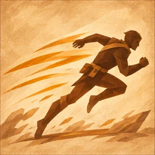
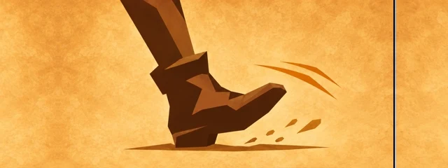
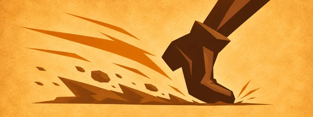

# Villain Run art style

## Card illustrations

Use **Adrenaline’s runner** as the starting reference for movement cards. Its pose reads from the outer contour alone. A few angular planes describe the body, and tapered amber strokes give the action a direction. The figure has almost no facial detail. The parchment carries the grain, so the silhouette stays sharp even in a small card window. The original illustration is [stride.webp](src/client/assets/table/stride.webp).

For a new movement illustration, block in the pose as a single dark shape first. Separate the limbs with gaps that survive at thumbnail size. Sampled starting colors from the runner are dark umber `#623011` for the figure, amber `#F49014` for motion marks, and warm parchment `#F6CD8D` for the ground. Let lighter and darker patches of grain show through the background.

Show temporary movement actions through a close-up of the footwork. **Back Step** lands on the heel with the toe lifted. **Charge** lifts the heel and drives off the toe. Leave parchment beneath the sole so the ground contact reads at card size. [Back Step](src/client/assets/table/back-step.webp) and [Charge](src/client/assets/table/charge.webp).

Other card families have their own palettes and subjects. The grasping hand in **Beckon** sits inside a violet spiral. **Vanish** dissolves a hooded figure into tan smoke. **Force Push** uses a violet arc and displaced fragments, melee uses a sweeping steel-blue blade trail, and range uses a drawn bow in ochre. Match the closest existing reference when extending a family. The [card art assignments](src/client/components/game/combat/dueling-table.css) show which image each card actually displays.

## Composition and in-game fit

Compose for the visible art window. The original runner is a square source cropped into a shallow rectangle. For a full-body move, use the runner as the pose reference. For a footwork close-up, center the boot and let the shin enter from the upper edge. Center the **figure itself** on both axes, then add the trail and dust. A useful starting pose occupies about three-fifths of the artwork’s height, with parchment beyond the head, feet, and leading hand. Export the illustration as WebP. The card renderer supplies the cost orb, glyph, title, and rules. [Card face layout](src/client/components/game/CardView.tsx).

Check the art in a hand at **288 px and 880 px game widths**. The movement window measured roughly **71 × 28 px** on the narrow layout and **71 × 34 px** on the wide layout. At that scale, check the figure’s head and feet, its separation from the upper-left cost orb and lower-right glyph, and whether you can tell the move from its pose with the title covered. Check the same card while dragging. For deck cards, also check the pile view.

## Battlefield, units, and frame

Battlefields use painted scenery with an open approach through the middle. In King’s Road, broad angular patches carry the eye up the road. In Elven Forest, the brightest architectural detail sits around the distant clearing. River Bridge uses converging parapets. Let the biome determine the palette, and keep the ground behind combatants quiet enough for their silhouettes to read. When adding a map, give it a display name and record its vanishing point and horizon in source-image percentages. The renderer aligns that horizon to 20% of the game frame. [Terrain artwork](src/client/assets/terrain) and [map registration](src/client/components/game/combat/Backdrop.tsx).

Humanoid units use hard-edged polygons, paired light and shadow planes, small facial marks, and distinctive headgear or props. Preserve those cues at back-row size. For a new humanoid, start with the existing figure geometry and appearance definitions. [Hero figure](src/client/components/game/combat/HeroFigure.tsx) and [hero appearances](src/client/content/heroLooks.ts).

The interface uses dark walnut and warm brass around the exposed battlefield. The hooded portrait uses a near-black face, two bright eyes, and a crimson hood. For frame work, use the open frame as the fit reference and check all four corners around the live battlefield and hand. [Open frame](src/client/assets/table/open-frame.webp), [walnut](src/client/assets/table/walnut.webp), and [portrait](src/client/assets/table/portrait.webp).
